  

  
  

---

## 🎮 Scheda personaggio

Sono Matteo, sviluppatore **full stack** con due motori sempre accesi: il codice e i mondi che mi appassionano.
Di giorno costruisco app, API e pannelli admin. Il resto del tempo lo divido tra la Formula 1, il mondo Ferrari e il conto alla rovescia per Leonida.

Ho iniziato come sviluppatore nel **web scraping e nell'automazione dati**, dove ho imparato una regola che porto ovunque: se una cosa la fai due volte a mano, la terza la scrivi in codice.

---

## 🧰 Ruota delle armi

   
   
  

---

## 🗺️ Missioni

### ⭐ Missione principale — `Ferrary` &nbsp;🔓 *nome svelato*

Un archivio tecnico di **tutte le Ferrari mai prodotte**, dalle stradali alla F1 fino ai prototipi.
Nessuna vendita, nessun prezzo: solo storia, dati e passione, organizzati come si deve.

- API REST in **Laravel** e frontend **React** in due repository separati
- Area admin costruita da zero, con tre livelli di staff
- Sito multilingua, autenticazione SPA con Sanctum
- Sviluppato con un approccio professionale: test e ambienti separati

---

## 🚨 Livello di ricercato

  

Cerco la mia **prossima missione**: un team dove crescere come Full Stack Developer, scrivere codice che resta in piedi e imparare da chi ne sa più di me.
Se pensate che possa fare al caso vostro, i contatti sono in fondo. 📱

---

## 📈 Attività su GitHub

  
  

  

---

## 📱 Contatti

  
  
  

---

<picture>
  <source media="(prefers-color-scheme: dark)" srcset="./assets/footer-dark.svg">
  <source media="(prefers-color-scheme: light)" srcset="./assets/footer-light.svg">
  
</picture>
